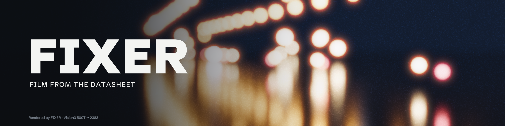
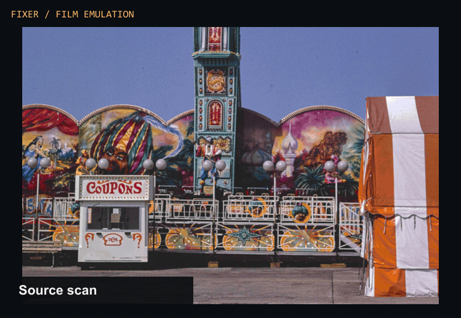
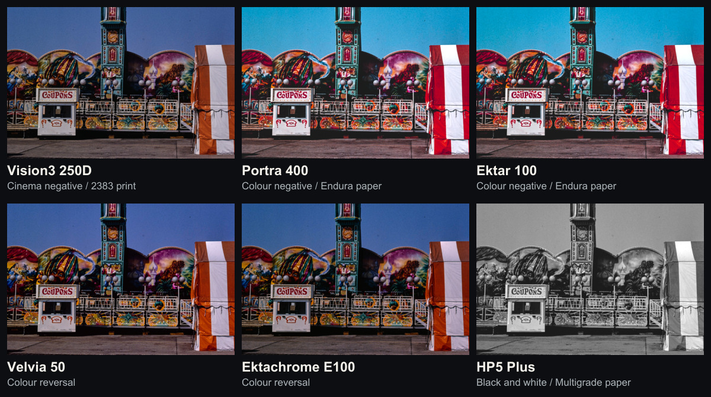
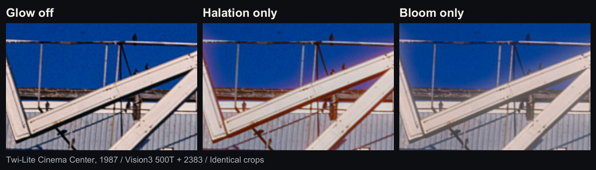
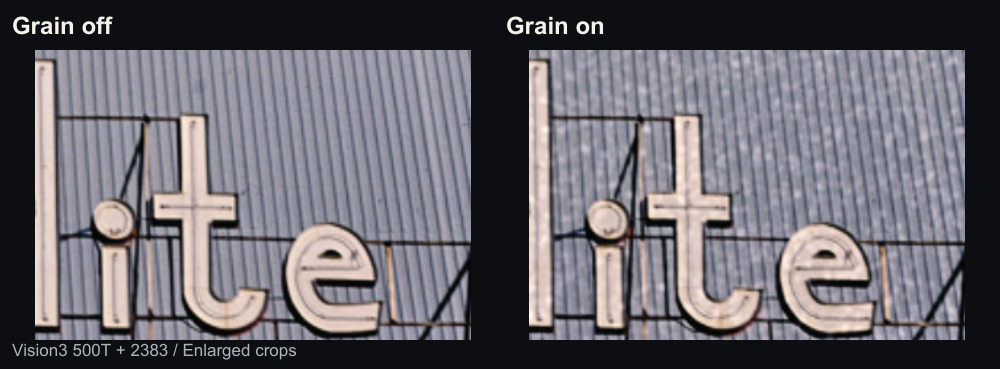
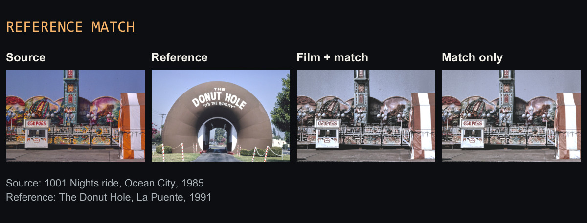

# FIXER



[](#install)
[](https://github.com/AllastorV/Fixer/archive/refs/tags/v1.1.0.zip)
[](https://github.com/AllastorV/Fixer/releases/download/v1.1.0/FIXER-1.1.0-win64-cuda-setup.exe)
[](LICENSE)

**Free, open-source film emulation and reference matching for DaVinci Resolve.**

FIXER models 41 film stocks from manufacturers’ published technical data, including cinema negatives with print film, still negatives with photographic paper, and directly viewed slides.

**Windows x64 · OpenFX**

[Film emulation](#film-emulation) · [Film controls](#film-controls) · [Reference match](#reference-match) · [Install](#install) · [User guide](docs/USER-GUIDE.md)

## Film emulation



The same 1985 Ocean City scan shows how cinema negatives, still negatives, slides and black-and-white film respond to the painted panels and blue sky. The gallery adds **Ektar 100** and **Ektachrome E100** for a six-stock comparison.

The film gallery and feature comparisons use a uniform +0.75 EV display adjustment.

[](docs/readme/film-stocks.jpg)

## Film controls

### Halation, bloom and grain

[](docs/readme/glow.jpg)

The bright edges of the **Twi-Lite Cinema Center** sign (1987) show halation’s warm fringe and bloom’s softer highlight spread. **Glow → Fast** computes both at half resolution. **Full** uses full resolution.

[](docs/readme/grain.jpg)

The grain comparison isolates **Grain → Amount** on Vision3 500T with 2383 print. **Size**, **Rate** and **Seed** control texture scale and how the pattern changes over time.

| Controls | What you can do |
| --- | --- |
| **Stock and print** | Choose from cinema, colour negative, black-and-white and reversal profiles. Use **Lab scan look** for the scan-fitted variant or turn it off for the datasheet model. |
| **Development and print** | Set push/pull in stops. Adjust print brightness and RGB balance with printer lights. |
| **Colour spaces** | Set input and output encoding for your Resolve workflow. The [user guide](docs/USER-GUIDE.md) covers DaVinci YRGB, Resolve Color Management and ACES. |

## Reference match

[](docs/readme/reference-match.jpg)

1. Open **Reference match** and choose a JPEG or PNG. FIXER reads it as sRGB.
2. Set **Order** to **Film + match** to build on the selected stock, or **Match only** to bypass the film emulation.
3. Click **Create grade** on the frame you want to match. Adjust **Strength** and **Protect skin tones**, then use **Show → Before match** to compare.

Matching transfers tone, saturation and colour casts from the reference. **Simple** is the current matching algorithm. **Detailed** currently uses the same algorithm. **Save look** stores a reusable `.json` and exports a `.cube` for **Match only** in Rec.709 Gamma 2.4.

## Install

### Windows installer (EXE)

Requires 64-bit Windows, DaVinci Resolve and a CUDA-capable NVIDIA GPU. The installer includes the FIXER OpenFX plugin and its ready-to-use film profiles and LUTs.

1. Close DaVinci Resolve.
2. Download and run [FIXER v1.1.0 for Windows x64](https://github.com/AllastorV/Fixer/releases/download/v1.1.0/FIXER-1.1.0-win64-cuda-setup.exe). Accept the Windows administrator prompt and complete setup.
3. Open Resolve, go to **Preferences → Memory and GPU**, and set **GPU processing mode** to **CUDA**. If you change the setting, restart Resolve.
4. On the **Color** page, add **OpenFX → FIXER → FIXER** to the last node after your scene grade.

For manual installation, extract the Windows CUDA ZIP from [GitHub Releases](https://github.com/AllastorV/Fixer/releases/latest) and run `install.bat` with Resolve closed. Then follow steps 3 and 4 above.

For a standard DaVinci YRGB workflow, feed **DaVinci Wide Gamut / Intermediate** into FIXER and select **Rec.709 / Gamma 2.4** as its output. FIXER performs tone mapping, so disable additional output tone mapping in managed projects. See the [node setups](docs/USER-GUIDE.md#node-trees) for the exact settings.

## Build from source

Use Visual Studio 2022 Build Tools with C++, CUDA 13.5, CMake 3.26 or later, Ninja, and Python 3.12 with `numpy`, `scipy` and `colour-science`.

Clone the repository with Git so you can initialize the OpenFX submodule. From the repository root, run these commands in an **x64 Native Tools Command Prompt** with CUDA, Ninja and Python on `PATH`.

```bat
git submodule update --init --recursive
python -m pip install numpy scipy colour-science
cmake -S . -B build\release -G Ninja -DCMAKE_BUILD_TYPE=Release
cmake --build build\release
```

The build produces `build\release\Fixer.ofx.bundle` with the plugin and baked LUTs. The repository also includes `build.bat` for the original development machine’s tool paths.

## Tests and roadmap

From the repository root after building, run the Python, CUDA and OFX tests.

```bat
cd bake
python -m unittest discover -s tests -p "test_*.py"
```

The [test tools](bake/tools) include Resolve render comparisons, stock and parameter checks, and Lab scan fitting. See the [numeric contract](docs/W01-numeric-contract.md) for tolerances.

Planned work includes OpenCL for AMD and Intel GPUs on Windows, Metal for macOS, and more film stocks.

## License and image credits

FIXER is licensed under [Apache-2.0](LICENSE). Film names identify the stocks being emulated. See [NOTICE](NOTICE) for project attribution.

The Library of Congress reports no known copyright restrictions on the archive photographs. The Acadia and Yellowstone photographs are public domain according to the U.S. National Park Service. See the [photo credits and render settings](docs/readme/CREDITS.md).
